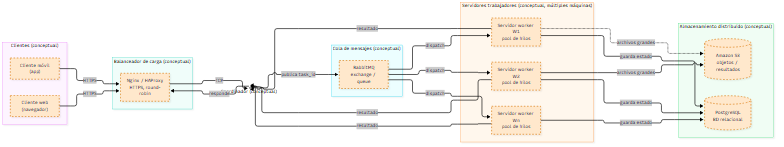
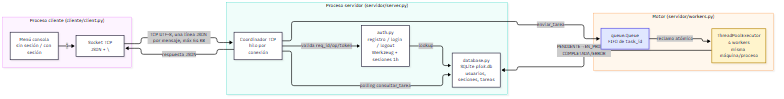

# PFO3 — Rediseño como Sistema Distribuido (Cliente–Servidor)

**Trabajo Práctico PFO3 — Programación sobre Redes**  
**Tecnicatura Superior en Desarrollo de Software — IFTS N.º 29**  
**Autor: Edison Cristian Vivar** (evolución de la PFO2)  
**Año académico: 2026**

> **Objetivo general:** transformar la aplicación cliente–servidor de la PFO2
> (Flask + `requests` + SQLite) en una solución con **sockets TCP**, **cola de
> tareas**, **concurrencia entre workers** y **procesamiento real de tareas**,
> conservando las funcionalidades existentes cuando resulta técnicamente
> apropiado.

> **Aviso sobre el alcance:** los hilos + `queue.Queue` demuestran
> **concurrencia**, no **distribución entre máquinas**. RabbitMQ, PostgreSQL,
> S3 y Nginx/HAProxy son el **diseño conceptual/de despliegue** solicitado por
> la consigna. La implementación funcional es: *cliente consola TCP →
> servidor coordinador → cola en memoria → 4 workers (hilos) → SQLite local*.
> Las secciones de arquitectura lo distinguen explícitamente.

---

## 1. Relación y evolución PFO2 → PFO3

| Aspecto | PFO2 (anterior) | PFO3 (actual) |
|---|---|---|
| Transporte | HTTP con Flask | **Sockets TCP** con `socket` |
| Serialización | JSON HTTP / HTML | **JSON por línea** (`\n`), máx. 64 KB |
| Cliente | `requests` HTTP | Cliente TCP consola (`socket` + `getpass`) |
| Tareas | `GET /tareas` HTML estático (sin CRUD) | **Tres tareas reales**: `suma`, `texto_mayusculas`, `fibonacci` |
| Concurrencia | Ninguna (Flask single-process) | **`queue.Queue` + `ThreadPoolExecutor` (4 workers)** |
| Autenticación | Flag local en el cliente | **Sesiones persistentes** (`token` + expiración 1 h) |
| Reutilizado | — | Esquema `usuarios` SQLite, hash Werkzeug, validaciones y estilo del menú PFO2 |

La tabla `tareas` de la PFO2 era un esqueleto sin uso. La PFO3 crea una tabla
nueva en `pfo3.db` y **no modifica** la `tareas.db` original.

---

## 2. Matriz de cumplimiento de la consigna

| Requisito oficial PFO3 | Estado | Dónde |
|---|---|---|
| Diagrama: clientes móviles y web | ✅ Conceptual | `docs/arquitectura_distribuida.mmd` |
| Diagrama: balanceador Nginx/HAProxy | ✅ Conceptual | idem |
| Diagrama: servidores workers con pool de hilos | ✅ Conceptual + funcional (hilos) | ambos diagramas |
| Diagrama: cola RabbitMQ | ✅ Conceptual (funcional: `queue.Queue`) | idem |
| Diagrama: PostgreSQL + S3 | ✅ Conceptual (funcional: SQLite local) | idem |
| Servidor Python que recibe tareas por socket y las distribuye | ✅ **Implementado** | `servidor/server.py` + `servidor/workers.py` |
| Cliente que envía tareas y recibe resultados | ✅ **Implementado** | `cliente/client.py` |
| Diagrama del sistema | ✅ | `docs/*.mmd` + `.png` |
| Código en GitHub | ⏳ Al publicar | Este repo (`PFO3_PSRedes_Vivar_Edison_Cristian`) |

---

## 3. Arquitectura

### 3.1 Arquitectura conceptual / de despliegue (consigna)



Fuente reproducible: [`docs/arquitectura_distribuida.mmd`](docs/arquitectura_distribuida.mmd)

> Clientes web/móvil → Nginx/HAProxy → coordinador → RabbitMQ → N servidores
> worker → PostgreSQL / S3. **No implementado**; representa la evolución a
> escala.

### 3.2 Arquitectura implementada (código real)



Fuente reproducible: [`docs/arquitectura_implementada.mmd`](docs/arquitectura_implementada.mmd)

> Cliente consola TCP (JSON + `\n`) → coordinador (hilo por conexión) →
> `queue.Queue` → `ThreadPoolExecutor` 4 workers → SQLite (`usuarios`,
> `sesiones`, `tareas`). Los workers son **hilos del mismo proceso**: hay
> concurrencia, no distribución física.

### 3.3 Flujo de una tarea

```text
Cliente --enviar_tarea {tipo, payload, token}--> Coordinador
  --> valida token (sesiones) --> INSERT tareas PENDIENTE --> encola task_id
  <-- {ok:true, task_id, estado:PENDIENTE} (ack inmediato)
Worker: get(task_id) --> reclamo atómico PENDIENTE -> EN_PROCESO
  --> ejecuta (sin transacción abierta) --> COMPLETADA + resultado / ERROR
Cliente --consultar_tarea {task_id, token}--> Coordinador (polling manual)
  <-- {estado, resultado, error} (solo si el dueño es el solicitante)
```

---

## 4. Tecnologías

**Utilizadas (reales, en el código):**

| Tecnología | Uso |
|---|---|
| Python 3.11 | Lenguaje de servidor, cliente y tests |
| `socket` TCP | Transporte cliente–servidor |
| `json` + delimitador `\n` | Serialización, máx. 64 KB por mensaje |
| `queue.Queue` | Cola FIFO de `task_id` |
| `ThreadPoolExecutor` (4) | Pool de workers persistentes |
| `sqlite3` (WAL) | Usuarios, sesiones, tareas |
| Werkzeug (`generate/check_password_hash`) | Hash de contraseñas (heredado de PFO2) |
| `secrets.token_hex(32)` | Tokens de sesión |
| `unittest` (stdlib) | 61 pruebas |

**Representadas conceptualmente (NO implementadas):** Nginx/HAProxy,
RabbitMQ, PostgreSQL, S3, TLS, clientes web/móvil. Ver diagrama conceptual.
No se agregaron por no ser necesarias para el alcance local y académico.

---

## 5. Estructura del repositorio

```text
PFO3_PSRedes_Vivar_Edison_Cristian/
├── servidor/
│   ├── server.py       # Coordinador TCP (dispatch, hilo por conexión)
│   ├── database.py     # SQLite: usuarios, sesiones, tareas
│   ├── workers.py      # Cola + 4 workers + recuperación
│   └── auth.py         # Registro, login, logout, tokens
├── cliente/
│   └── client.py       # Menú de consola TCP
├── compartido/
│   └── protocolo.py    # JSON por línea, LineReader, req_id/op
├── docs/
│   ├── arquitectura_distribuida.mmd
│   ├── arquitectura_implementada.mmd
│   ├── arquitectura_distribuida.png
│   ├── arquitectura_implementada.png
│   └── capturas/       # Evidencias (pendientes, ver §13)
├── tests/
│   ├── test_protocolo.py            # 16
│   ├── test_integracion.py          # 9
│   ├── test_tareas.py               # 17
│   ├── test_auth.py                 # 10
│   ├── test_integracion_final.py    # 6
│   └── test_robustez.py             # 3
├── requirements.txt
├── .gitignore
└── README.md
```

---

## 6. Instalación

```powershell
cd "PFO3_PSRedes_Vivar_Edison_Cristian"

# Clonar
git clone https://github.com/<usuario>/PFO3_PSRedes_Vivar_Edison_Cristian.git
cd PFO3_PSRedes_Vivar_Edison_Cristian

# Entorno virtual limpio (verificado)
py -m venv .venv
.venv\Scripts\activate

# Dependencias (solo Werkzeug; el resto es stdlib)
pip install -r requirements.txt
```

## 7. Ejecución (PowerShell, verificada)

```powershell
# Terminal 1 — servidor (crea pfo3.db si no existe)
python -m servidor.server 127.0.0.1 5000
# Apagado: Ctrl+C (cierre controlado)

# Terminal 2 — cliente
python cliente/client.py
# (También funciona: python -m cliente.client)
```

## 8. Uso completo (ejemplo)

Con el servidor corriendo, en el cliente:

1. **Sin sesión → `1` Registrarse** → `ana` / `secreto123`  
   → *Usuario registrado correctamente*
2. **Sin sesión → `2` Iniciar sesión** → `ana` / `secreto123` (oculto con `getpass`)  
   → *Bienvenido, ana. (El token no se muestra.)*
3. **Con sesión → `1` Enviar tarea** → `1` Suma → `2` / `3`  
   → *Tarea creada: <uuid> / Estado: PENDIENTE…*
4. **Con sesión → `2` Listar mis tareas** → muestra id / tipo / estado  
5. **Con sesión → `3` Consultar estado y resultado** → pega el `task_id`  
   → *Estado: COMPLETADA / Resultado: 5*
6. **Con sesión → `4` Cerrar sesión** → *Sesión cerrada correctamente*  
7. **Con sesión → `5` Salir**

Tipos admitidos: `suma` (`a`, `b` números finitos), `texto_mayusculas`
(`texto` ≤ 10.000), `fibonacci` (`n` entero 0–100).

## 9. Protocolo de comunicación

- Transporte: TCP UTF-8, **una línea JSON por mensaje** con `\n` final.
- Lectura por **buffer hasta `\n`** (`LineReader`), nunca `recv() == mensaje`.
- Límite **64 KB por línea** (sin contar `\n`). Mensaje mayor → 
  `mensaje_demasiado_grande` y cierre.
- Cada solicitud lleva **`req_id`** (string único) y **`op`**. Cada respuesta
  repite `req_id` (o `null` si no pudo extraerse).
- Una solicitud por vez **dentro de cada conexión**, concurrencia **entre
  conexiones** (hilo por conexión). Correlación por `req_id`.

```json
// Solicitud
{"req_id":"c8f2e1a4","op":"enviar_tarea","token":"<64hex>","tipo":"suma","payload":{"a":2,"b":3}}
// Respuesta éxito tarea
{"req_id":"c8f2e1a4","ok":true,"task_id":"<uuid>","estado":"PENDIENTE"}
// Respuesta éxito consulta
{"req_id":"…","ok":true,"task_id":"<uuid>","estado":"COMPLETADA","resultado":5,"error":null,"tipo":"suma"}
// Error tipificado
{"req_id":"…","ok":false,"error":{"codigo":"credenciales_invalidas","mensaje":"Usuario o contraseña incorrectos"}}
```

| `op` | Campos extra | Token |
|---|---|---|
| `registro` | `usuario`, `contraseña` | No |
| `login` | `usuario`, `contraseña` | No |
| `logout` | — | Sí |
| `enviar_tarea` | `tipo`, `payload` | Sí |
| `consultar_tarea` | `task_id` | Sí |
| `listar_tareas` | — (máx. 100) | Sí |

Códigos de error: `json_invalido`, `sobre_invalido`, `mensaje_demasiado_grande`,
`op_desconocida`, `autenticacion_requerida`, `credenciales_invalidas`,
`usuario_duplicado`, `payload_invalido`, `tarea_no_encontrada`, `error_interno`.

## 10. Workers y estados

| Estado | Significado |
|---|---|
| `PENDIENTE` | Persistida y encolada |
| `EN_PROCESO` | Reclamada atómicamente por un worker |
| `COMPLETADA` | Resultado persistido (`finalizada`) |
| `ERROR` | Mensaje de procesamiento persistido |

Flujo interno: `get(task_id)` → `UPDATE ... WHERE estado='PENDIENTE'`
(solo un dueño gana) → cómputo **sin transacción abierta** → `finalizar`.
Deadlocks reducidos: conexión SQLite corta por operación, `timeout=15`, WAL.

## 11. Persistencia

- Archivo: **`pfo3.db`** (independiente de `tareas.db`, que no se modifica).
- Tablas: `usuarios(id, usuario UNIQUE, contraseña)` (compatible PFO2),
  `sesiones(token PK, usuario_id FK, creada, expira)`, `tareas(task_id PK,
  usuario_id, tipo, payload JSON, estado, resultado JSON, error, creada,
  iniciada, finalizada)`.
- **Recuperación básica** (no exactamente-una-vez ante cualquier fallo):
  `PENDIENTE` se re-encola al iniciar, `EN_PROCESO` → `PENDIENTE`, 
  `COMPLETADA/ERROR` jamás se re-ejecutan.

## 12. Seguridad

- Hash Werkzeug (scrypt), nunca texto plano ni hash expuesto en respuestas.
- Consultas parametrizadas (`?`), validación de payload y límites de tamaño.
- Tokens `secrets.token_hex(32)`, expiración 1 h, invalidación por `logout`.
- Aislamiento: consultar/listar filtra por `usuario_id`; ajena == inexistente
  (`tarea_no_encontrada`, sin revelación).
- **Limitación:** token por TCP **sin cifrado** — válido solo en `127.0.0.1`.
  Exponerlo a red real exigiría **TLS**.
- Servidor por defecto en `127.0.0.1:5000`. Sin logs de tokens/contraseñas.

## 13. Pruebas

**Comando (verificado):**

```powershell
python -m unittest discover -s tests -v
```

**Resultado real:**

```text
Ran 61 tests in ~21s
OK
```

Desglose: 16 protocolo (fragmentado/pegados/64 KB/EVP) · 9 integración Etapa 2
(actualizada a `op_desconocida`) · 17 tareas (persistencia/estados/recuperación)
· 10 auth (registro/login/sesiones/aislamiento) · 6 integración final (2
usuarios simultáneos, expiración, timeouts, reinicio) · 3 robustez
(regresiones F1/F2/F3 de auditoría).

## 14. Limitaciones conocidas y mejoras futuras

1. Hilos ≠ distribución física; 1 sola instancia admitida (2 instancias no
   soportadas para recuperación concurrente).
2. Recuperación **básica**: tarea tras fallo transitorio de BD queda
   `PENDIENTE` (recuperable al reiniciar); no exactamente-una-vez.
3. `listar_tareas` capado a 100 (cabe en 64 KB con payloads habituales; una
   lista muy grande de entradas largas aún podría excederlo).
4. TCP sin TLS; cierre abrupto puede generar RST (ruido, sin impacto).
5. Sin rate-limiting; sin clientes web/móvil reales.

**Futuro:** RabbitMQ en vez de `queue.Queue`, PostgreSQL + S3, Nginx/HAProxy,
TLS, paginación de listados, escalado horizontal por máquinas.

## 15. Autor

**Edison Cristian Vivar** — Trabajo Práctico PFO3, Programación sobre Redes,
Tecnicatura Superior en Desarrollo de Software, IFTS N.º 29 (2026).
Evolución técnica trazable desde la PFO2 (mismo autor, backend SQLite/Werkzeug),
sin copiar código de terceros: las referencias de compañeros se consultaron
solo como contraste organizativo.
